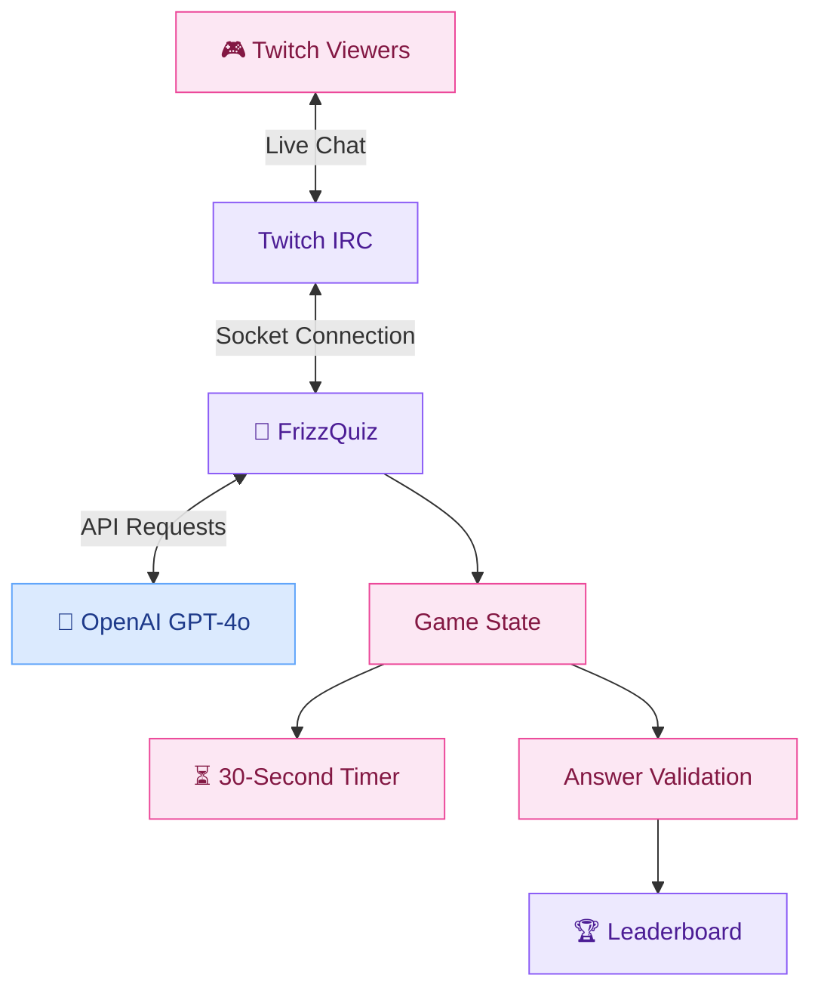
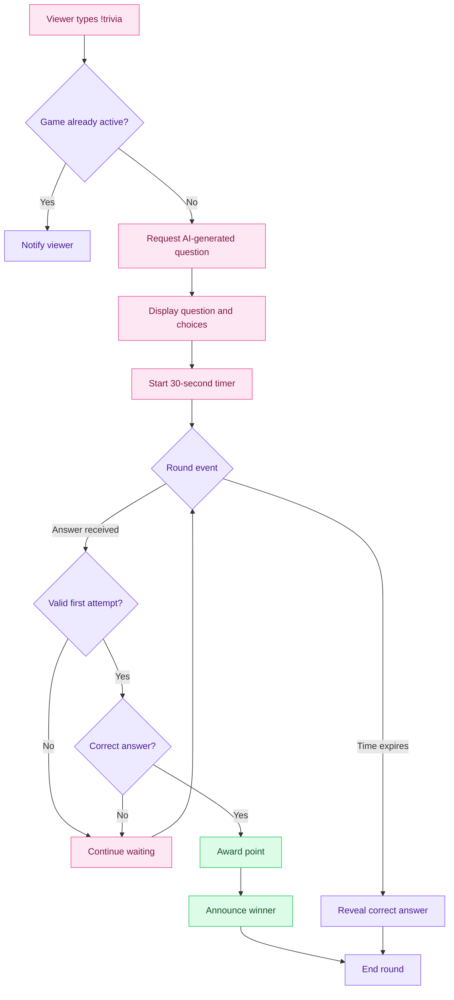
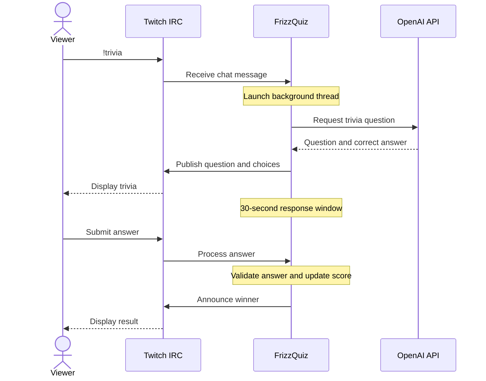

# 🎮 FrizzQuiz | AI-Powered Twitch Trivia Bot


## 💜 About FrizzQuiz

FrizzQuiz is an interactive, AI-powered trivia bot developed in Python for Twitch live-streaming communities. The application integrates Twitch's Internet Relay Chat (IRC) protocol with the OpenAI API to dynamically generate video game trivia questions and encourage real-time audience participation.

The project combines artificial intelligence, network programming, concurrent processing, and interactive game mechanics to create an engaging experience for streamers and their communities.

## ✨ Project Motivation

As a Twitch Partner since 2018, a former competitive Call of Duty player, and a Computer Science graduate currently pursuing a Master's degree in Computer Science, I wanted to combine my passion for gaming, software development, and artificial intelligence.

I independently developed FrizzQuiz to provide my Twitch community with an interactive experience that encourages viewer engagement, friendly competition, and community participation.

## 🚀 Features

- AI-generated video game trivia using GPT-4o.
- Real-time Twitch chat integration through IRC.
- Multiple-choice questions with four possible answers.
- Timed trivia rounds with a 30-second response window.
- Automated answer validation and scoring.
- One recognized answer attempt per viewer per round.
- Session-based leaderboard displaying the top five players.
- Multithreaded trivia execution.
- Real-time chat message processing.
- Twitch IRC PING/PONG handling.
- Automatic winner announcements.

## 🏗️ System Architecture

FrizzQuiz communicates with Twitch through a socket-based IRC connection and uses the OpenAI API to dynamically generate trivia content.



## 🎯 Trivia Game Workflow

The following diagram illustrates the intended control flow of a trivia round, from question generation to answer validation and scoring.



## 🔄 Real-Time Communication

FrizzQuiz uses multithreading to execute trivia rounds while continuing to process incoming Twitch chat messages.

The following sequence diagram demonstrates communication between viewers, Twitch IRC, FrizzQuiz, and the OpenAI API during a successful trivia round.



## 💻 Technologies Used

| Technology | Purpose |
|---|---|
| Python | Core application development |
| OpenAI API | Dynamic trivia question generation |
| GPT-4o | Generative artificial intelligence |
| Twitch IRC | Real-time chat communication |
| Socket Programming | Network communication |
| Threading | Concurrent trivia execution |
| Regular Expressions | Message parsing and answer extraction |
| Python Dictionaries | Leaderboard and score tracking |
| Python Sets | Tracking viewer answer attempts |

## 🎮 Chat Commands

| Command | Description |
|---|---|
| `!trivia` | Starts a new trivia round |
| `!leaderboard` | Displays the top five players |
| `A` | Selects answer A |
| `B` | Selects answer B |
| `C` | Selects answer C |
| `D` | Selects answer D |

## 🕹️ Example Gameplay

The following is an illustrative example of a trivia round.

```text
Viewer: !trivia

FrizzQuiz: 🎮 VIDEO GAME TRIVIA TIME! <3

FrizzQuiz: Which company developed Minecraft?

FrizzQuiz: A : Ubisoft
FrizzQuiz: B : Mojang
FrizzQuiz: C : Rockstar Games
FrizzQuiz: D : Electronic Arts

FrizzQuiz: ⏳ You have 30 seconds! Type A, B, C, or D.

Viewer: B

FrizzQuiz: 🎉 Viewer got it right! Answer was B.
You now have 1 point(s).

Viewer: !leaderboard

FrizzQuiz: 🏆 Leaderboard: viewer: 1
```

## 🧠 Technical Implementation

### Artificial Intelligence Integration

FrizzQuiz uses the OpenAI API with GPT-4o to dynamically generate multiple-choice video game trivia questions.

Prompt engineering is used to request structured responses containing four answer choices and the correct answer. Regular expressions extract the correct answer and format the generated content for Twitch chat.

### Network Programming

The application establishes a socket connection to Twitch's IRC server to send and receive chat messages in real time.

Incoming messages are buffered and parsed to identify usernames, commands, and trivia answers. PING/PONG messages are handled to maintain the IRC connection.

### Concurrent Programming

Python's threading module allows trivia rounds to execute in a background thread while the main application continues listening for incoming chat messages.

This allows the bot to receive viewer responses while a trivia round is active.

### Game State Management

The application maintains information about the active trivia round, correct answer, viewer participation, and leaderboard scores.

Python sets are used to track viewer answer attempts, while dictionaries store player scores.

### Scoring System

The first viewer to submit the correct answer receives one point. The leaderboard ranks players by their total scores and displays the five highest-scoring participants.

## ⚙️ Installation and Setup

### Prerequisites

- Python 3
- OpenAI API account and API key
- Twitch account
- Twitch OAuth token
- Internet connection

### Step 1: Clone the Repository

Clone this repository using Git or GitHub Desktop.

### Step 2: Install Dependencies

```bash
pip install openai
```

The remaining modules used by the application are included in Python's standard library.

### Step 3: Configure Credentials

Open `trivia_bot.py` and configure the following values locally:

```python
OPENAI_API_KEY = "YOUR_OPENAI_API_KEY"
TWITCH_TOKEN = "oauth:YOUR_TWITCH_TOKEN"
BOT_NICK = "YOUR_BOT_USERNAME"
CHANNEL = "#YOUR_TWITCH_CHANNEL"
```

The credentials included in this repository are placeholders.

Never commit actual API keys, OAuth tokens, passwords, or other sensitive credentials to a public repository.

### Step 4: Run FrizzQuiz

```bash
python trivia_bot.py
```

Once the bot connects to Twitch IRC, enter `!trivia` in the configured Twitch channel to start a trivia round.

## 📂 Project Structure

```text
FrizzQuiz/
│
├── trivia_bot.py    # Core application
└── README.md        # Project documentation
```

## 📚 Computer Science Concepts Demonstrated

- Object and data state management
- Application programming interfaces
- Generative artificial intelligence
- Prompt engineering
- Network programming
- Socket communication
- Concurrent programming
- Real-time event processing
- Regular expressions
- Data structures
- Algorithmic problem-solving
- Interactive application development

## 📌 Current Limitations

- Leaderboard scores are stored in memory and reset when the application restarts.
- AI-generated trivia questions may occasionally repeat or contain inaccuracies.
- Authentication credentials currently require manual configuration.
- Shared game state does not currently use synchronization locks.
- Answer parsing requires stricter validation to prevent ordinary chat messages from being interpreted as answers.
- The current IRC implementation uses an unencrypted socket connection.

## 🔮 Future Improvements

- [ ] Persistent leaderboard storage using a database.
- [ ] Environment variable-based credential management.
- [ ] Secure IRC connections using TLS.
- [ ] Thread-safe game state management.
- [ ] Improved answer validation.
- [ ] Automatic reconnection and improved error handling.
- [ ] Duplicate question detection.
- [ ] Trivia categories and difficulty levels.
- [ ] Moderator-only trivia controls.
- [ ] Customizable trivia settings.
- [ ] Viewer participation and engagement analytics.
- [ ] Web-based configuration dashboard.
- [ ] Automated testing.

## 👩‍💻 About the Developer

**Constance Rios**

- M.S. in Computer Science — In Progress
- B.S. in Computer Science — Cum Laude
- A.S. in Computer Science
- NSF ExCELS Scholar
- Twitch Partner since 2018
- Former competitive Call of Duty player
- Aspiring Machine Learning Engineer

I am passionate about artificial intelligence, machine learning, software engineering, and developing technology that creates meaningful experiences for online communities.

[](https://github.com/ConstanceR1)

---

<p align="center">
  💜 Independently developed with a passion for gaming, technology, and community. 💜
</p>
